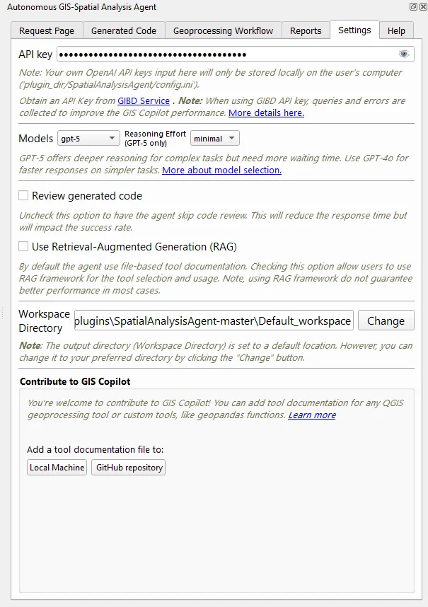

# Configuration and data handling

Everything in the <strong>Settings</strong> tab: model provider, key, reasoning effort, code review, and workspace. It also covers what data each option sends where.

<figure class="medium">
  
  <figcaption>The Settings tab (earlier capture). In 1.4 the model list is longer, a <em>local</em> option adds Base URL and model fields, and the RAG checkbox is gone.</figcaption>
</figure>

## Choose a model provider

| Provider | Choose when… | You need |
| --- | --- | --- |
| **OpenAI** | You have an OpenAI account and want the strongest hosted models | An OpenAI API key |
| **GIBD service** | You want access through the GIBD Lab's service | A key from [gibd.online](https://www.gibd.online/) (contains `gibd-services`) |
| **Local** | Data or policy requires that prompts stay on your own infrastructure | A running OpenAI-compatible server such as Ollama or LM Studio |

### Hosted models (OpenAI or GIBD)

<ol class="steps">
  <li>Paste the key into <strong>API key</strong>. Use the eye icon to check it.</li>
  <li>Choose a model under <strong>Models</strong>.</li>
  <li>Optionally set <strong>Reasoning Effort</strong> (see <a href="#analysis-settings">below</a>).</li>
</ol>

The 1.4 dropdown lists:

| Identifier | Notes |
| --- | --- |
| `gpt-6-luna` | Default selection in 1.4 |
| `gpt-5.2`, `gpt-5.1`, `gpt-5` | Reasoning models; support Reasoning Effort |
| `gpt-4o`, `gpt-4`, `gpt-4o-mini` | Faster; useful for simple tasks |
| `local` | Switches to the local server fields |

These identifiers are configured in the plugin; availability depends on your provider and account. If a request fails with a model error, pick one your endpoint supports. A previously saved selection is restored on startup.

**Routing:** a key containing `gibd-services` sends requests through `gibd.online`. Any other hosted key goes directly to OpenAI.

GIBD quotas
Earlier guides described a free daily quota ending December 31, 2025. That offer is historical. Check [gibd.online](https://www.gibd.online/) for current terms.

### Local models

<ol class="steps">
  <li>Start your model server and load a model.</li>
  <li>Choose <strong>local</strong> under <strong>Models</strong>.</li>
  <li>Enter the server's OpenAI-compatible <strong>Base URL</strong>, <em>including</em> <code>/v1</code>.</li>
  <li>Select <strong>Fetch models</strong> and pick the exact model identifier, or type it.</li>
  <li>Send a small test request, such as "How many features are in &lt;layer&gt;?"</li>
</ol>

Common Base URLs:

| Server | Default Base URL | Example model identifier |
| --- | --- | --- |
| Ollama | `http://localhost:11434/v1` | `llama3.1:70b` |
| LM Studio | `http://localhost:1234/v1` | as shown in LM Studio's server tab |
| vLLM / other | `http://<host>:<port>/v1` | the served model name |

*Fetch models* probes the OpenAI-compatible, Ollama, and LM Studio listing endpoints. A model appearing in the list doesn't guarantee it can generate correct QGIS code. Expect smaller local models to need more precise, step-by-step requests.

The URL and model are saved under `[LocalModel]` in the config file. The key is stored as the placeholder `no-api`, so this path suits servers that **don't require authentication**. There is no custom auth field yet.

"local" is about the endpoint, not the machine
`localhost` means the computer running QGIS. If the Base URL points to another machine, your prompts go to that machine.

## Analysis settings

| Setting | What it does | Recommendation |
| --- | --- | --- |
| **Reasoning Effort** (`minimal` / `low` / `medium` / `high`) | How much the reasoning models think before answering, for models that support it. | `low` or `medium` for most work. Use `high` for complex multi-step tasks. |
| **Review generated code** | Adds a model review pass before execution. | Keep it on. Turning it off is faster but lowers the success rate. |
| **Workspace Directory** | Output folder passed to code generation. Select **Change** to pick a folder. | Use a project folder you control, not the plugin's `Default_workspace`. |

When `gpt-5` is selected, some internal stages use `gpt-4o` for speed. Other selections are used as-is. See `get_model_for_operation` in [SpatialAnalysisAgent_helper.py](https://github.com/Teakinboyewa/SpatialAnalysisAgent/blob/master/SpatialAnalysisAgent/SpatialAnalysisAgent_helper.py).

Older guides mention **Chat Mode** and a **RAG** toggle. Neither is in the 1.4 interface.

## Credentials and request data

### Where keys are stored

Keys are written in plain text to `SpatialAnalysisAgent/config.ini` inside the installed plugin folder. Some values are also kept in QGIS settings. This is not an encrypted vault:

- don't commit `config.ini`;
- crop keys out of screenshots and bug reports.

### What is sent during an analysis

Storing the key locally doesn't mean your analysis stays local. The selected endpoint receives prompts assembled from:

- your request text;
- a **data overview**: layer names, paths, field names and types, CRS, and one sample row of attribute values per layer;
- tool documentation;
- generated code and any error messages during debugging.

Review this before analysing sensitive data, and consider a local model.

### Data sent to GIBD

| When | Sent to `gibd.online` | Key types affected |
| --- | --- | --- |
| Every request | A request-ID call | GIBD keys only |
| Model calls | All prompts above (proxied to the model) | GIBD keys only |
| An execution error | Request, error and traceback, generated code, data overview, task breakdown, selected tools | GIBD keys only |
| You select 👍, 👎, or the feedback-message button | Rating, your optional comment, request text, request ID | GIBD keys only. With other keys the buttons show a notice and send nothing |

With an OpenAI key or a local model, nothing in this table is sent to GIBD. To share feedback in that case, use [GitHub issues](https://github.com/Teakinboyewa/SpatialAnalysisAgent/issues).

For GIBD's retention and usage terms, see [gibd.online](https://www.gibd.online/). These pages don't set provider policies.
