# Case study gallery

Real runs from the GIS Copilot evaluation. Each card shows the request as typed, the tools the agent selected, and a screenshot of the result. Select any image to enlarge it.

The evaluation groups tasks into three levels:

| Level | What the agent receives | What it must do |
| --- | --- | --- |
| Basic | A direct request, usually one tool and one or two layers | Pick the right tool and parameters |
| Intermediate | Several steps, often numbered | Generate and chain correct code for each step |
| Advanced | A goal, without steps | Design the method, select tools, and execute end to end |

Datasets and the full test set
Datasets for these cases, plus 100+ more test cases, are on the [GIS Copilot test page](https://giscience.psu.edu/copilot_test/) and in the [case study PDF](https://github.com/Teakinboyewa/SpatialAnalysisAgent/raw/master/Doc/Case%20Studies/GIS_Copilot_Case_Studies.pdf). These screenshots span several plugin releases and models, and a rerun today may produce different code.

## Basic

  <article class="case">
    <figure><figcaption hidden>Buffers around DC health facilities</figcaption></figure>
    

      Basic · vector
      <h3>Health facility service zones</h3>
      
"Can you please create 2000-feet zones around each health facilities in Washington DC to identify areas of service coverage?"

      
Tools: <code>native:buffer</code>

    

  </article>
  <article class="case">
    <figure>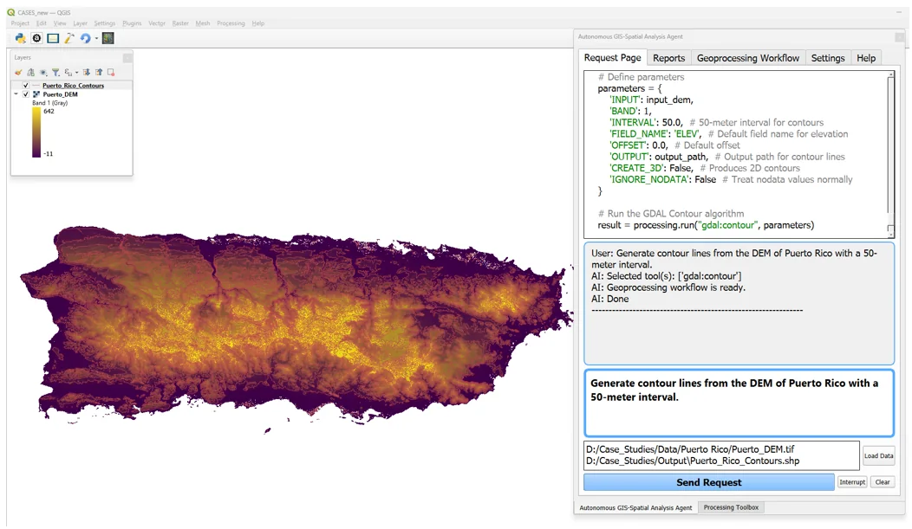<figcaption hidden>Contours from the Puerto Rico DEM</figcaption></figure>
    

      Basic · raster
      <h3>Contours from a DEM</h3>
      
"Generate contour lines from the DEM of Puerto Rico with a 50-meter interval."

      
Tools: <code>gdal:contour</code>

    

  </article>
  <article class="case">
    <figure>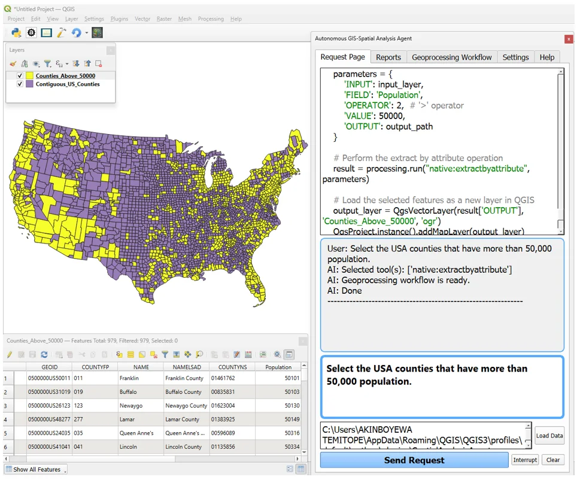<figcaption hidden>Counties above 50,000 population</figcaption></figure>
    

      Basic · vector
      <h3>Attribute selection</h3>
      
"Select the USA counties that have more than 50,000 population."

      
Tools: <code>native:extractbyattribute</code> · <a href="examples.html#tutorial-1-select-counties-by-population">Tutorial</a>

    

  </article>
  <article class="case">
    <figure>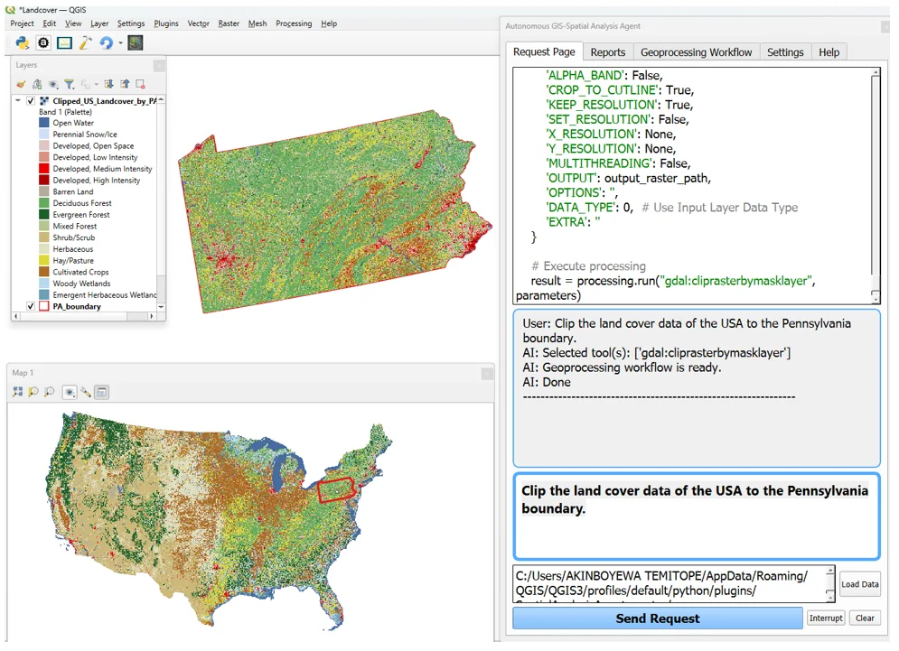<figcaption hidden>Land cover clipped to Pennsylvania</figcaption></figure>
    

      Basic · raster
      <h3>Clip land cover to a state</h3>
      
"Clip the land cover data of the USA to the Pennsylvania boundary."

      
Tools: <code>gdal:cliprasterbymasklayer</code> · <a href="examples.html#tutorial-2-clip-a-land-cover-raster-to-a-state">Tutorial</a>

    

  </article>
  <article class="case">
    <figure>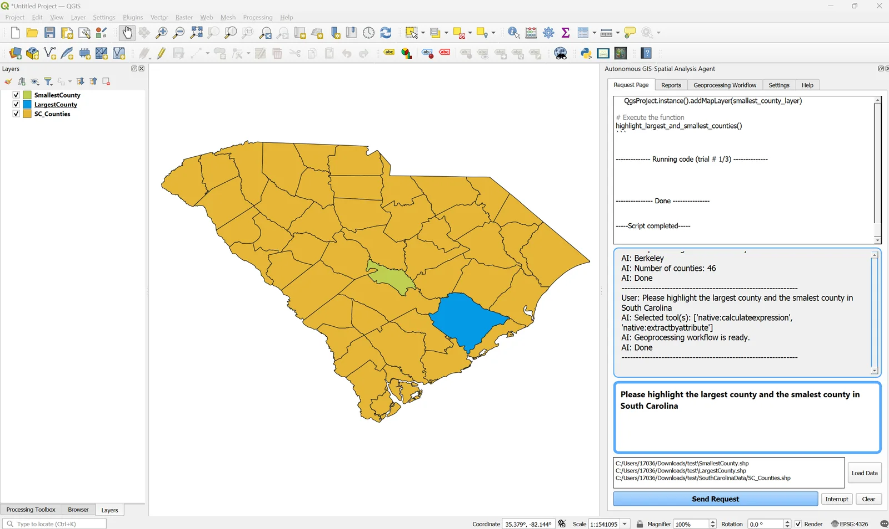<figcaption hidden>Largest and smallest SC county</figcaption></figure>
    

      Basic · vector
      <h3>Largest and smallest county</h3>
      
"Please highlight the largest county and the smallest county in South Carolina."

      
Tools: <code>native:calculateexpression</code>, <code>native:extractbyattribute</code>

    

  </article>
  <article class="case">
    <figure><figcaption hidden>Roads shorter than 100 m</figcaption></figure>
    

      Basic · vector
      <h3>Reproject, measure, extract</h3>
      
"1) Reproject this road vector layer to NAD27 / UTM Zone 10. 2) Create a new field containing the road features' length. Let the name of the field be "Length". 3) Extract roads that have length shorter than 100 meters."

      
Tools: <code>native:reprojectlayer</code>, <code>native:fieldcalculator</code>, <code>native:extractbyexpression</code>

    

  </article>
  <article class="case">
    <figure>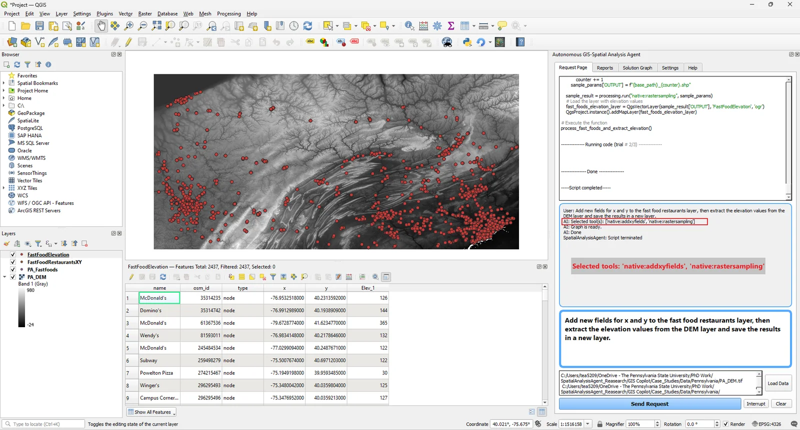<figcaption hidden>Elevation sampled at fast food restaurants</figcaption></figure>
    

      Basic · raster + vector
      <h3>Sample elevation at points</h3>
      
"Add new fields for x and y to the fast food restaurants layer, then extract the elevation values from the DEM layer and save the results in a new layer."

      
Tools: <code>native:addxyfields</code>, <code>native:rastersampling</code>

    

  </article>
  <article class="case">
    <figure><figcaption hidden>SC population change chart</figcaption></figure>
    

      Basic · table + chart
      <h3>Population change chart</h3>
      
A field calculation of population change between 2000 and 2008 for each South Carolina county, plotted as a bar chart.

      
Output: chart in the <strong>Reports</strong> tab

    

  </article>

## Intermediate

  <article class="case">
    <figure>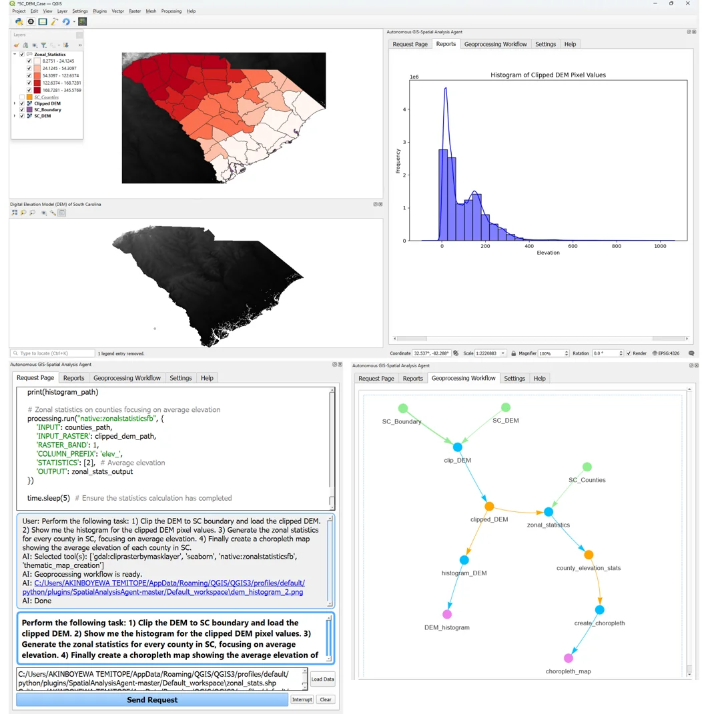<figcaption hidden>South Carolina zonal statistics</figcaption></figure>
    

      Intermediate · raster + vector
      <h3>Clip, histogram, zonal statistics, choropleth</h3>
      
"1) Clip the DEM to SC boundary and load the clipped DEM. 2) Show me the histogram for the clipped DEM pixel values. 3) Generate the zonal statistics for every county in SC, focusing on average elevation. 4) Finally create a choropleth map showing the average elevation of each county in SC."

      
Tools: <code>gdal:cliprasterbymasklayer</code>, <code>seaborn</code>, <code>native:zonalstatisticsfb</code>, thematic map

    

  </article>
  <article class="case">
    <figure>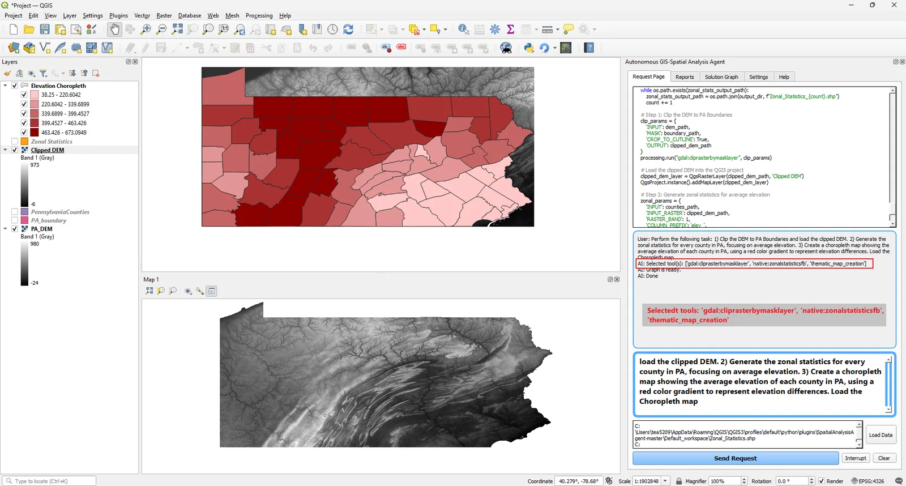<figcaption hidden>Pennsylvania mean elevation choropleth</figcaption></figure>
    

      Intermediate · raster + vector
      <h3>Mean elevation per county</h3>
      
"1) Clip the DEM to PA Boundaries and load the clipped DEM. 2) Generate the zonal statistics for every county in PA, focusing on average elevation. 3) Create a choropleth map … using a red color gradient."

      
Tools: <code>gdal:cliprasterbymasklayer</code>, <code>native:zonalstatisticsfb</code>, thematic map · <a href="examples.html#tutorial-3-mean-elevation-per-county-choropleth">Tutorial</a>

    

  </article>
  <article class="case">
    <figure>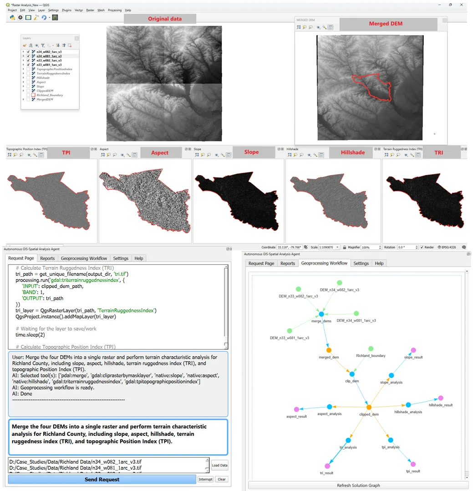<figcaption hidden>Richland County terrain analysis</figcaption></figure>
    

      Intermediate · raster
      <h3>Terrain characteristics</h3>
      
"Merge the four DEMs into a single raster and perform terrain characteristic analysis for Richland County, including slope, aspect, hillshade, terrain ruggedness index (TRI), and topographic Position Index (TPI)."

      
Tools: merge, clip by mask, slope, aspect, hillshade, TRI, TPI (7 algorithms)

    

  </article>
  <article class="case">
    <figure>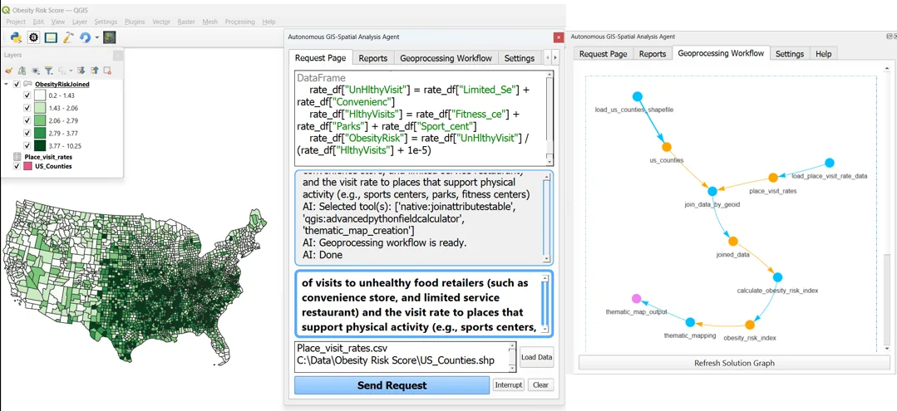<figcaption hidden>Obesity risk behaviour index</figcaption></figure>
    

      Intermediate · vector + table
      <h3>Obesity risk behaviour index</h3>
      
"Generate an obesity risk behavior index of each county in the contiguous US by analyzing the rate of visits to unhealthy food retailers … and the visit rate to places that support physical activity … Visualize the results in a thematic map."

      
Tools: <code>native:joinattributestable</code>, <code>qgis:advancedpythonfieldcalculator</code>, thematic map

    

  </article>
  <article class="case">
    <figure>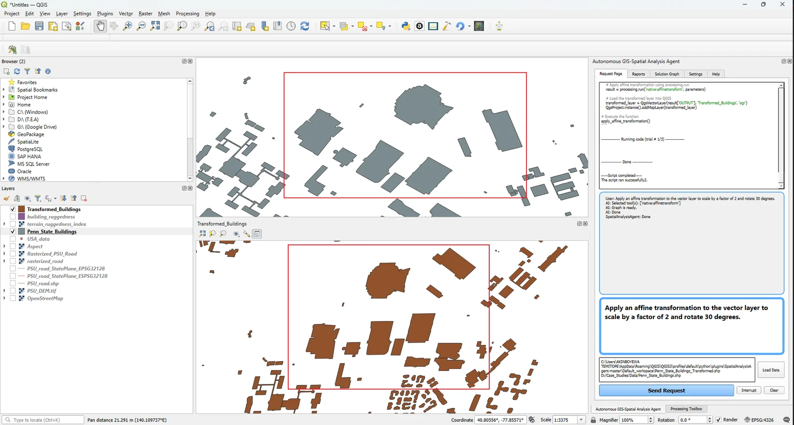<figcaption hidden>Affine transformation of buildings</figcaption></figure>
    

      Intermediate · vector
      <h3>Affine transformation</h3>
      
"Apply an affine transformation to the vector layer to scale by a factor of 2 and rotate 30 degrees."

      
Tools: <code>native:affinetransform</code>

    

  </article>

## Advanced

  <article class="case">
    <figure>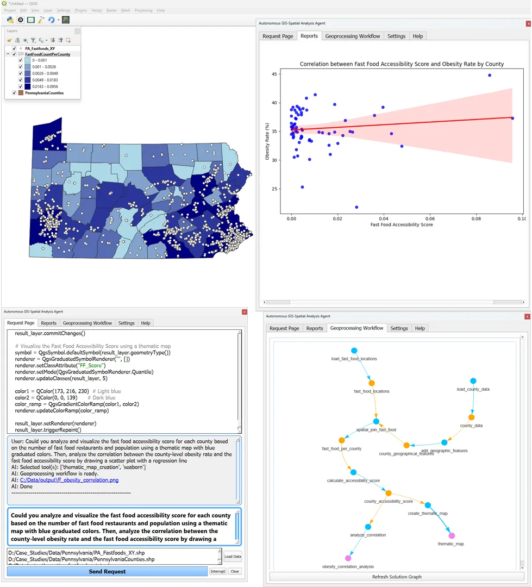<figcaption hidden>Fast food accessibility and obesity</figcaption></figure>
    

      Advanced · vector + chart
      <h3>Fast food accessibility vs. obesity</h3>
      
"Could you analyze and visualize the fast food accessibility score for each county … using a thematic map with blue graduated colors. Then, analyze the correlation between the county-level obesity rate and the fast food accessibility score by drawing a scatter plot with a regression line."

      
Tools: thematic map, <code>seaborn</code> · <a href="examples.html#tutorial-4-fast-food-accessibility-and-obesity">Tutorial</a>

    

  </article>
  <article class="case">
    <figure>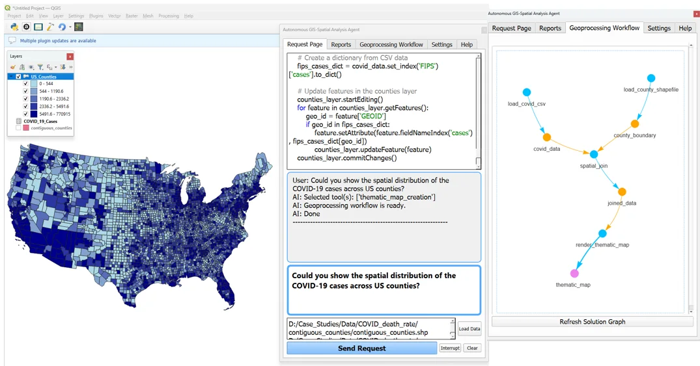<figcaption hidden>COVID-19 cases by county</figcaption></figure>
    

      Advanced · vector + table
      <h3>COVID-19 cases by county</h3>
      
"Could you show the spatial distribution of the COVID-19 cases across US counties?"

      
Tools: thematic map. The agent joined a CSV to counties by FIPS on its own initiative.

    

  </article>
  <article class="case">
    <figure>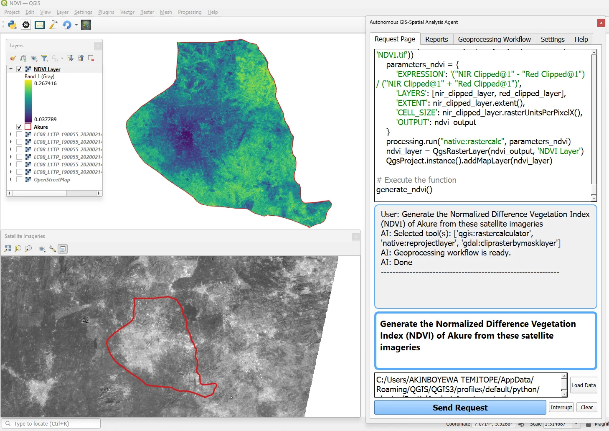<figcaption hidden>NDVI of Akure</figcaption></figure>
    

      Advanced · multiband raster
      <h3>NDVI from Landsat</h3>
      
"Generate the Normalized Difference Vegetation Index (NDVI) of Akure from these satellite imageries."

      
Tools: <code>qgis:rastercalculator</code>, <code>native:reprojectlayer</code>, <code>gdal:cliprasterbymasklayer</code> · <a href="examples.html#tutorial-5-ndvi-from-landsat-imagery">Tutorial</a>

    

  </article>
  <article class="case">
    <figure>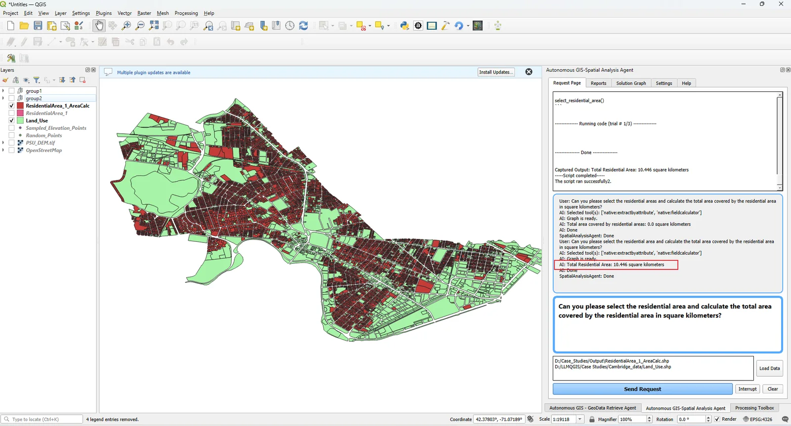<figcaption hidden>Residential area total</figcaption></figure>
    

      Advanced · vector
      <h3>Total residential area</h3>
      
"Can you please select the residential area and calculate the total area covered by the residential area in square kilometers?"

      
Tools: <code>native:extractbyattribute</code>, <code>native:fieldcalculator</code> · result 10.446 km². See <a href="examples.html#lesson-always-check-the-numbers">why the first run said 0</a>.

    

  </article>
  <article class="case">
    <figure>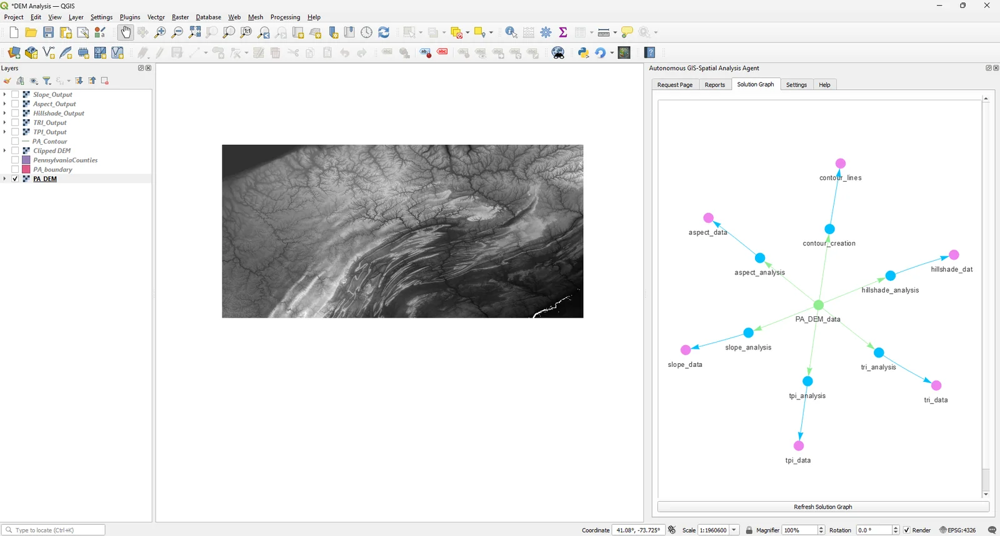<figcaption hidden>Pennsylvania DEM analysis</figcaption></figure>
    

      Advanced · raster
      <h3>Full DEM characterisation</h3>
      
A Pennsylvania DEM analysed in one request into slope, aspect, hillshade, TRI, TPI, and contours. The graph fans out from a single input.

      
Output: six derived layers

    

  </article>
  <article class="case">
    <figure>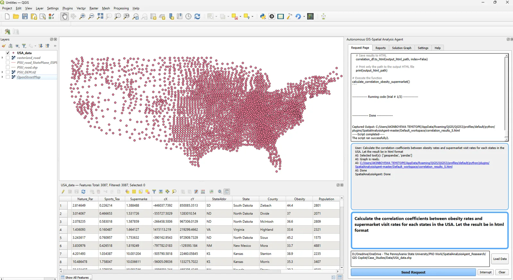<figcaption hidden>Obesity and supermarket visits correlation</figcaption></figure>
    

      Advanced · table + report
      <h3>Correlation by state</h3>
      
"Calculate the correlation coefficients between obesity rates and supermarket visit rates for each states in the USA. Let the result be in html format."

      
Tools: <code>geopandas</code>, <code>pandas</code>. HTML table opened in Reports.

    

  </article>

## Explore further

- [Illustrated case studies on GitHub](https://github.com/Teakinboyewa/SpatialAnalysisAgent/blob/master/Case_Studies.md)
- [More demonstrations on the GIBD website](https://giscience.psu.edu/gis-copilot-demonstrations/)
- [Video demonstrations](videos.md)
