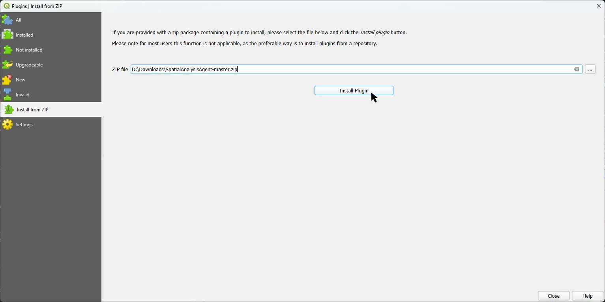
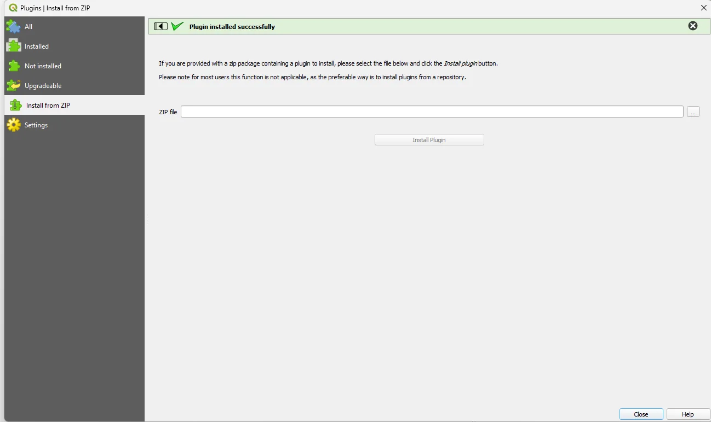
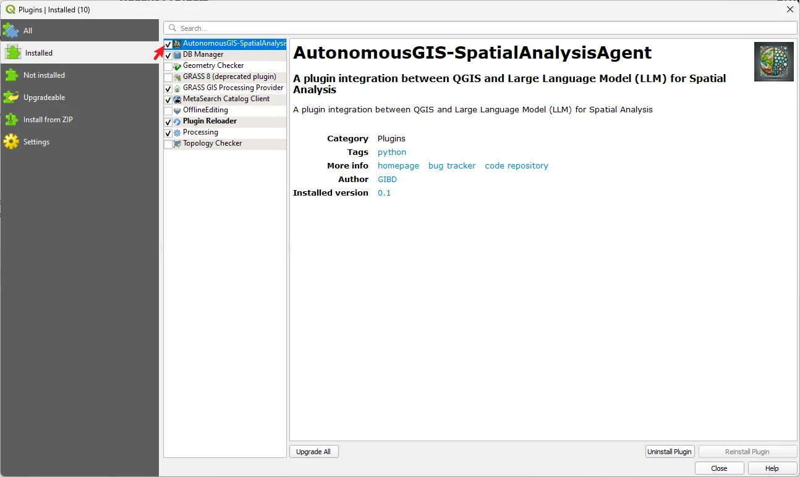
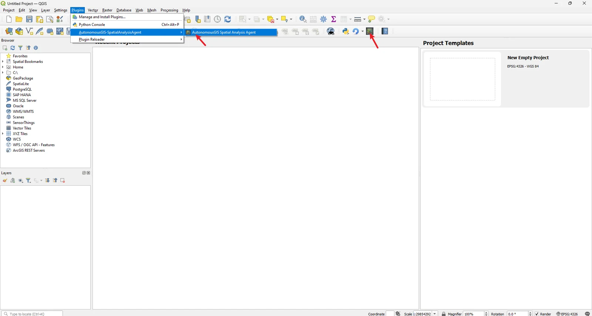
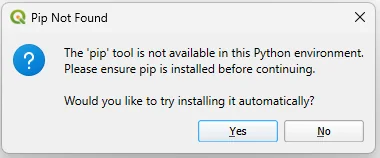

# Installation

<p class="lead">Install the plugin, enable it, and let it install its Python packages. Plan for about 10 minutes, mostly spent downloading dependencies.</p>

## Before you begin

| Requirement | Details |
| --- | --- |
| **QGIS desktop** | A current QGIS 3 release. Version 1.4 includes fixes for recent releases such as 3.44 (see the changelog in [metadata.txt](https://github.com/Teakinboyewa/SpatialAnalysisAgent/blob/master/metadata.txt)). |
| **Python** | 3.11 or newer, meaning the Python bundled with QGIS. Check it in the Python Console (shown [below](#find-the-qgis-python-environment)). |
| **Model access** | An OpenAI API key, a [GIBD service](https://www.gibd.online/) key, or a reachable OpenAI-compatible local model server. See [Configuration](configuration.md). |
| **Internet** | Needed to install dependencies and to call a hosted model. |
| **Disk** | A writable folder for outputs (the *Workspace Directory*). |

<div class="callout note" markdown="1">
<span class="callout-title">About the minimum QGIS version</span>
`metadata.txt` declares QGIS 3.0 as the minimum. That value is not a tested compatibility matrix. The Python dependencies need a QGIS build that ships Python 3.11 or newer.
</div>

## Option A: Install from the QGIS catalog (recommended)

<ol class="steps">
  <li>In QGIS, open <strong>Plugins → Manage and Install Plugins…</strong></li>
  <li>Select <strong>All</strong>, then search for <code>AutonomousGIS-SpatialAnalysisAgent</code>.</li>
  <li>Select <strong>Install Plugin</strong> and wait for the confirmation message.</li>
</ol>

The catalog page is [plugins.qgis.org/plugins/SpatialAnalysisAgent-master](https://plugins.qgis.org/plugins/SpatialAnalysisAgent-master/).

## Option B: Install from a ZIP

Use this route when you need the latest repository version before it reaches the catalog.

<ol class="steps">
  <li>Download the <a href="https://github.com/Teakinboyewa/SpatialAnalysisAgent/archive/refs/heads/master.zip">repository ZIP</a>. Do not extract it.</li>
  <li>Open <strong>Plugins → Manage and Install Plugins… → Install from ZIP</strong>.</li>
  <li>Select <strong>…</strong>, choose the downloaded <code>SpatialAnalysisAgent-master.zip</code>, then select <strong>Install Plugin</strong>.</li>
</ol>

<figure>
  
  <figcaption>The <em>Install from ZIP</em> page with the downloaded archive selected.</figcaption>
</figure>

<figure>
  
  <figcaption>A green <em>Plugin installed successfully</em> banner confirms the install. You can close the dialog.</figcaption>
</figure>

<div class="callout warning" markdown="1">
<span class="callout-title">Only keep one copy installed</span>
Don't install the catalog version and a ZIP or development copy at the same time. QGIS may load the wrong one, and settings can appear to "disappear". Uninstall one before installing the other.
</div>

## Enable and open the plugin

<ol class="steps">
  <li>In <strong>Plugins → Manage and Install Plugins… → Installed</strong>, make sure <strong>AutonomousGIS-SpatialAnalysisAgent</strong> is checked.</li>
  <li>Open it from <strong>Plugins → AutonomousGIS-SpatialAnalysisAgent → AutonomousGIS Spatial Analysis Agent</strong>, or select its toolbar icon.</li>
</ol>

<figure>
  
  <figcaption>The plugin is enabled when its checkbox in the <em>Installed</em> list is ticked.</figcaption>
</figure>

<figure>
  
  <figcaption>Two ways to open the panel: the <em>Plugins</em> menu entry, or the toolbar icon (arrowed).</figcaption>
</figure>

The panel docks on the right side of the QGIS window. You can drag it to another dock area or float it.

## Install dependencies

The first time you open the plugin, it checks for its Python packages. If any are missing or at the wrong version, a dialog lists them.

<div class="figure-row">
  <figure class="narrow">
    
    <figcaption>Select <strong>Yes</strong> to install the listed packages into the QGIS Python environment.</figcaption>
  </figure>
  <figure class="narrow">
    
    <figcaption>If <code>pip</code> is missing, the plugin offers to install it first. Select <strong>Yes</strong>, then restart QGIS.</figcaption>
  </figure>
</div>

<ol class="steps">
  <li>Select <strong>Yes</strong> and wait. Installation can take several minutes and QGIS may look unresponsive during it.</li>
  <li><strong>Restart QGIS</strong> when installation finishes. This also applies after a pip install.</li>
  <li>Reopen the plugin. The dialog should not appear again. If it does, see <a href="troubleshooting.html#missing-modules-or-package-incompatibilities">Troubleshooting</a>.</li>
</ol>

The package list and version constraints are in [install_packages/requirements.txt](https://github.com/Teakinboyewa/SpatialAnalysisAgent/blob/master/install_packages/requirements.txt). The list includes OpenAI, LangChain, NetworkX, PyVis, GeoPandas, pandas, Pydantic, seaborn, Rasterio, and TOML parsers.

<div class="callout warning" markdown="1">
<span class="callout-title">Don't pass requirements.txt to pip directly</span>
The file uses a custom `package:import_name` format that only the plugin's installer understands. `pip install -r requirements.txt` will fail.
</div>

## Install a package manually

If one package fails to install automatically, install it from inside QGIS so it lands in the right environment.

### Find the QGIS Python environment

Open **Plugins → Python Console** (<kbd>Ctrl</kbd>+<kbd>Alt</kbd>+<kbd>P</kbd>) and run:

```python
import sys
print(sys.version)   # must be 3.11 or newer
print(sys.prefix)    # the environment packages must be installed into
```

### Install from the Python Console

Using `openai` as an example:

```python
import pip
pip.main(['install', 'openai'])
```

Restart QGIS afterwards. On macOS and Linux you can also call the QGIS interpreter from a terminal, for example:

```bash
/Applications/QGIS.app/Contents/MacOS/bin/python3 -m pip install openai
```

Adjust the path to match your QGIS installation. Installing into a system Python or a separate virtual environment will **not** fix imports inside QGIS.

<div class="callout tip" markdown="1">
<span class="callout-title">Binary packages</span>
NumPy, pandas, GeoPandas, and Rasterio depend on compiled libraries that QGIS also ships. Before upgrading or replacing them, read the full traceback. A version mismatch with QGIS's own copies is a common cause of import errors.
</div>

## Next steps

1. Open **Settings**, enter a key or configure a local model, and pick a writable **Workspace Directory**. See [Configuration](configuration.md).
2. Follow [Your first analysis](quickstart.md).
