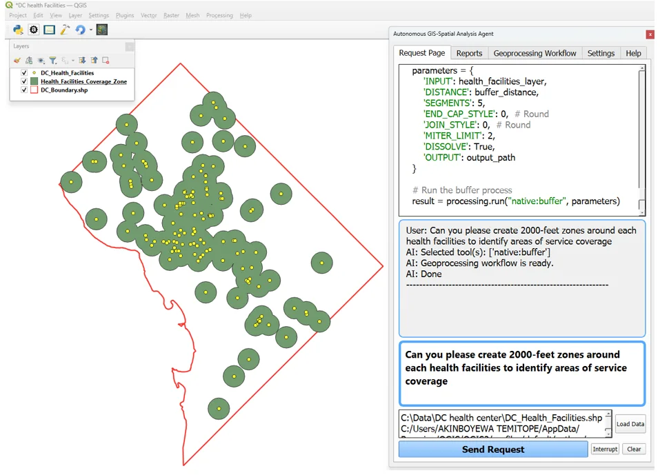
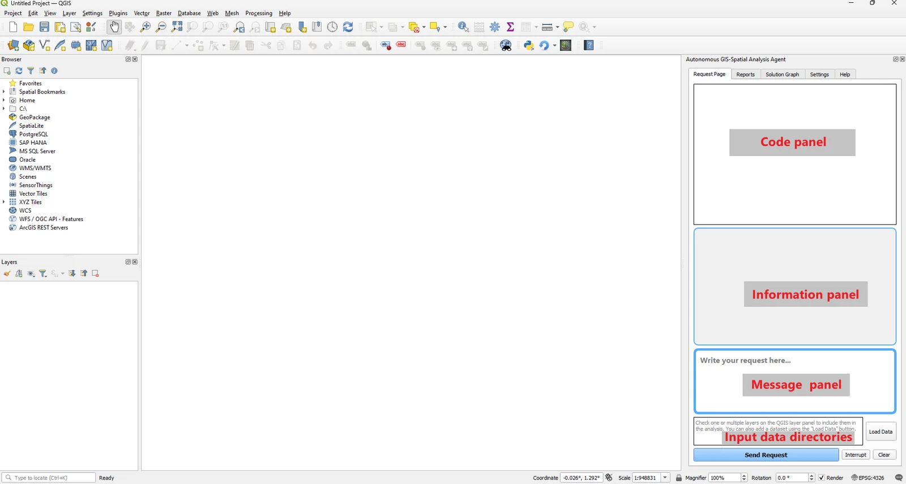

# Your first analysis

<p class="lead">This walkthrough creates service-coverage zones around health facilities. Along the way it shows each part of the interface and what to check before you trust a result.</p>

| | |
| --- | --- |
| **Time** | About 10 minutes |
| **You need** | The plugin [installed](installation.md) and a [configured model](configuration.md) |
| **Data** | Any point layer. This guide uses Washington, DC health facilities and the DC boundary from the [case study datasets](https://giscience.psu.edu/copilot_test/). |
| **You'll learn** | How to select inputs, send a request, read progress, and verify output |
{: .meta-table}

<figure>
  
  <figcaption>The finished result. Buffers around each DC health facility, with the generated <code>native:buffer</code> code and progress log in the panel.</figcaption>
</figure>

## 1. Get to know the panel

<figure>
  
  <figcaption>The <em>Request Page</em>. Generated code streams into the top panel, progress appears in the middle, and you type requests below. (Captured on an earlier release; the layout is the same in 1.4.)</figcaption>
</figure>

| Area | What it's for |
| --- | --- |
| **Code panel** | Shows code as it's generated and the execution log (`Running code (trial # 1/3)`, `Done`). |
| **Information panel** | The conversation: your request, selected tools, workflow status, links to report files. |
| **Message panel** | Where you type the request. |
| **Data paths** | File paths of the layers that will be analysed. Updated from the Layers panel or **Load Data**. |
| **Send Request / Interrupt / Clear** | Start, ask to stop, or clear the panels. |

## 2. Prepare the data

<ol class="steps">
  <li>Load the point layer into QGIS, for example <code>DC_Health_Facilities.shp</code>.</li>
  <li><strong>Check its CRS</strong> (<em>Layer Properties → Information</em>). Buffer distances are in the layer's units. For a geographic CRS such as EPSG:4326 the unit is degrees, so ask GIS Copilot to reproject first. A projected CRS in feet or metres can be used directly.</li>
  <li>In the <strong>Layers</strong> panel, tick the layers to include and untick everything else. The ticked layers' paths appear in the data paths box.</li>
</ol>

<div class="callout tip" markdown="1">
<span class="callout-title">Name layers clearly</span>
The model sees layer names and file paths. `DC_Health_Facilities` is far easier to refer to than `export_final_2`. Rename layers in the Layers panel before you write a request.
</div>

## 3. Configure the plugin

Open **Settings** and:

- enter your API key and choose a model, or choose **local** and set the Base URL (see [Configuration](configuration.md));
- set a writable **Workspace Directory**;
- leave **Review generated code** ticked for your first runs. It adds a review pass that improves the success rate.

## 4. Send the request

Go back to **Request Page** and type:

> Create 2000-foot buffer zones around each feature in DC_Health_Facilities to show service coverage. Dissolve overlapping buffers. Save the result as Health_Facilities_Coverage_Zone.shp in the workspace and add it to the map.

Select **Send Request**. The information panel will report progress similar to:

```text
User: Create 2000-foot buffer zones around each feature in DC_Health_Facilities ...
AI: Selected tool(s): ['native:buffer']
AI: Geoprocessing workflow is ready.
AI: Done
```

Meanwhile the code panel fills with the generated script. The core of it looks like this:

```python
parameters = {
    'INPUT': health_facilities_layer,
    'DISTANCE': buffer_distance,   # in the layer's CRS units
    'SEGMENTS': 5,
    'END_CAP_STYLE': 0,            # Round
    'JOIN_STYLE': 0,               # Round
    'MITER_LIMIT': 2,
    'DISSOLVE': True,
    'OUTPUT': output_path,
}
result = processing.run("native:buffer", parameters)
```

How long it takes depends on the model, the reasoning effort, and whether code review is on. Multi-step requests take longer because they make more model calls.

## 5. Check the result

The new layer appears in the Layers panel. Before you use it:

<ol class="steps">
  <li><strong>Measure a buffer.</strong> Use the <em>Measure Line</em> tool from a point to its buffer edge. If the radius is 2000 degrees or 2000 metres instead of 2000 feet, the CRS units were not handled.</li>
  <li><strong>Read the code.</strong> Open <strong>Generated Code</strong> and confirm the distance, the dissolve setting, and the output path.</li>
  <li><strong>Review the plan.</strong> Open <strong>Geoprocessing Workflow</strong> to see the operations and how they connect.</li>
  <li><strong>Find the file.</strong> Confirm the output exists in your workspace folder.</li>
  <li><strong>Save the script.</strong> Use <strong>Save as a Python File</strong> to keep it.</li>
</ol>

<div class="callout warning" markdown="1">
<span class="callout-title">"Done" is not "correct"</span>
`AI: Done` means the code executed without raising an error. It does not mean the distance, units, or method were right. Always run at least one manual check.
</div>

## 6. Iterate

Each request is analysed on its own, so restate the full context when you refine. For example:

> Create 500-metre buffers around DC_Health_Facilities after reprojecting it to EPSG:26985 (NAD83 / Maryland, metres). Keep overlapping buffers separate. Save as facility_buffers_500m.gpkg and add it to the map.

You can also edit the script yourself in **Generated Code** and select **Run Code**.

## Rate the response

Below the request box are **thumbs up**, **thumbs down**, and **feedback message** buttons. With a GIBD key they send your rating or comment, the request text, and the request ID to the GIBD feedback service. With other keys they show a notice and send nothing. See [Configuration → Credentials and request data](configuration.md#credentials-and-request-data).

## What next?

- [Interface and workflows](user-guide.md) covers every tab in depth.
- [Writing effective requests](prompts.md) has templates for common tasks.
- [Step-by-step tutorials](examples.md) walk through raster, multi-step, and charting analyses.
