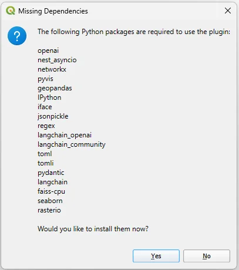

# Troubleshooting and FAQ

Find your symptom below. For problems that aren't listed, <a href="#report-an-issue">report an issue</a>.

## Quick diagnosis

| Symptom | Likely cause | Go to |
| --- | --- | --- |
| Plugin missing from the Plugins menu | Not enabled, or failed to load | [Plugin does not load](#plugin-does-not-load) |
| "Missing Dependencies" every time QGIS starts | Install failed or went to the wrong Python | [Missing modules](#missing-modules-or-package-incompatibilities) |
| `No module named 'pkg_resources'` | Older plugin release on new QGIS | [Update to 1.4](#no-module-named-pkg_resources) |
| `401`, `invalid_api_key`, `model_not_found` | Key or model problem | [Authentication](#authentication-or-unavailable-model) |
| Fetch models fails or returns nothing | Local server URL or server state | [Local model](#local-model-connection-or-discovery-fails) |
| QGIS crashes after code runs | Pre-1.4 threading issue | [Crashes](#qgis-crashes-after-execution) |
| "Done" but the output is wrong | Request ambiguity, CRS or units | [Wrong result](#execution-succeeds-but-the-result-is-wrong) |
| `Running code (trial # 5/5)` then failure | Debugging couldn't fix the error | [Repeated failures](#execution-keeps-failing) |

## Installation

### Plugin does not load

1. Check that it's ticked in **Plugins → Manage and Install Plugins… → Installed**.
2. Restart QGIS after any dependency change.
3. Open **View → Panels → Log Messages** and check the *Python error* tab for the first failing import.
4. On a development checkout, make sure only **one copy** of the plugin is installed.

### Missing modules or package incompatibilities

<figure class="narrow">
  
  <figcaption>If this dialog keeps returning after a restart, installation didn't complete.</figcaption>
</figure>

- Let installation finish fully, then **restart QGIS**.
- If installation fails, note the package and error. Check network access, proxy and firewall settings, and write permissions to the QGIS Python folder.
- Install the failing package manually from the QGIS Python Console. See [Installation → Install a package manually](installation.md#install-a-package-manually).
- [install_packages/requirements.txt](https://github.com/Teakinboyewa/SpatialAnalysisAgent/blob/master/install_packages/requirements.txt) lists the version constraints. Its format is **not** compatible with `pip install -r`.
- For NumPy, pandas, GeoPandas, or Rasterio errors, read the full traceback first. These packages link to binaries that QGIS ships, and upgrading them blindly can break QGIS itself.

### No module named 'pkg_resources'

Fixed in version 1.4. Update the plugin from **Plugins → Manage and Install Plugins… → Upgradeable**.

### "Pip not found"

Accept the automatic pip install, then **restart QGIS** before installing the other packages.

## Models and connections

### Authentication or unavailable model

- Re-paste the key in **Settings** (use the eye icon to check for trailing spaces).
- Confirm the account has API access and credit.
- Pick a different model. Not every listed identifier is available on every account or endpoint.
- For GIBD, confirm the key contains `gibd-services`.

Never include a key in a bug report.

### Local model connection or discovery fails

1. Confirm the server is running and a model is loaded. For example, `curl http://localhost:11434/v1/models` should list it.
2. Check the Base URL: host, port, and the trailing `/v1`.
3. Select **Fetch models** and read any error shown.
4. Use the exact callable identifier, not a display name.
5. If discovery works but generation fails, check the server log. The plugin sends the placeholder key `no-api`, so servers that require authentication will reject it.

`localhost` is the computer running QGIS. A server elsewhere needs its reachable address.

### Request seems slow

A request involves several model calls (inspection, breakdown, tool selection, graph, code, review) plus geoprocessing and possibly up to five execution attempts. To speed it up:

- turn down **Reasoning Effort**;
- use a smaller dataset to test the method first;
- split a long request into stages.

**Interrupt** asks the run to stop but cannot undo completed steps. Inspect partial outputs before rerunning.

## Execution

### Execution keeps failing

After five failed attempts the run stops. Then:

1. Read the last error in the **Output Window** (Generated Code tab).
2. Check for common causes: a misspelled field name, a layer that isn't file-backed, mismatched CRS, or a missing Processing provider (for example GRASS or SAGA not installed).
3. Rewrite the request with exact names and units. Or fix the script yourself and select **Run Code**.

### Execution succeeds but the result is wrong

"Done" means no exception was raised. Work through this list:

- [ ] Were the **right layers** ticked, and only those?
- [ ] Did the code use the **field names** you meant?
- [ ] Are distances and areas in a **projected CRS** with the units you expected?
- [ ] For rasters: correct **band**, **NoData**, and **resolution**?
- [ ] Does a hand calculation on one feature match?

Then rewrite the request with the missing assumptions spelled out. See [Writing effective requests](prompts.md) and the [worked example of a silent zero result](examples.md#lesson-always-check-the-numbers).

### QGIS crashes after execution

Version 1.4 fixed intermittent "access violation" crashes by running generated code on the QGIS main thread. Update the plugin. If crashes persist, report them with the QGIS crash dump.

### No report or graph appears

Not every task produces a report. Reports appear only for charts or HTML outputs. Check the information panel for a file path, and look in the workspace folder.

## FAQ

**Does GIS Copilot need internet access?**
For hosted models, yes. With a local model server, analysis runs without internet access. Installing dependencies needs it once.

**Can I use it with any QGIS Processing algorithm?**
GIS Copilot selects from the tools it has documentation for, which cover most native QGIS and GDAL algorithms plus libraries such as GeoPandas and seaborn. You can [add documentation for more tools](development.md#tool-documentation-format). The algorithm must also be installed in your QGIS.

**Is my data uploaded?**
Your files aren't uploaded, but a **data overview** (layer names, paths, fields, CRS, and a sample row of values) is included in prompts. See [what is sent](configuration.md#what-is-sent-during-an-analysis).

**Can I review code before it runs?**
Not in 1.4. Code runs as soon as it's generated. To stage changes, work on a copy of your data or in a scratch workspace, and use **Generated Code → Run Code** to rerun after editing.

**Which model works best?**
Start with the default (`gpt-6-luna`) or a `gpt-5.x` model with code review on, especially for multi-step tasks. Faster models such as `gpt-4o-mini` can handle simple single-tool requests. Results vary, so test on a small dataset first.

**Can I reuse the script without the plugin?**
Yes. **Save as a Python File** and run it in the QGIS Python Console. It needs the same input paths and packages.

**How do I cite GIS Copilot?**
See [Research and citation](index.md#research-and-citation).

## Report an issue

Open a [GitHub issue](https://github.com/Teakinboyewa/SpatialAnalysisAgent/issues) with:

- QGIS, Python, operating system, and plugin versions;
- installation method (catalog, ZIP, development checkout) and provider/model;
- the exact request, a description of the inputs (geometry, CRS, key fields), and steps to reproduce;
- expected vs. actual behaviour, and the traceback from the Output Window or Log Messages.

Before posting
Remove API keys, private paths, and sensitive dataset content from text and screenshots.

