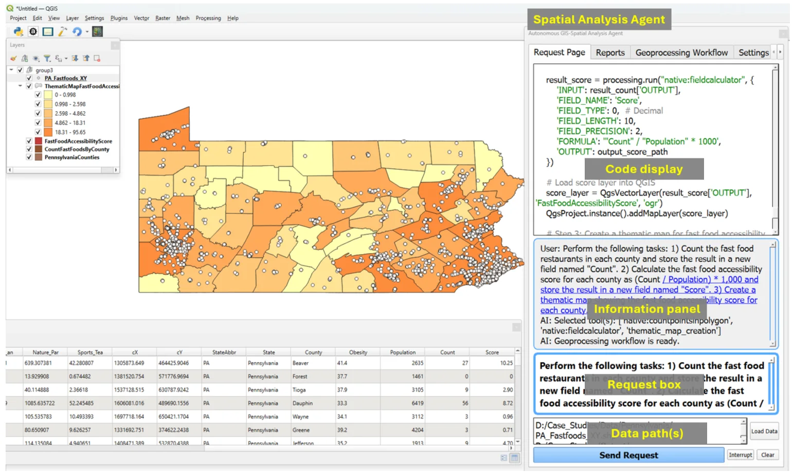
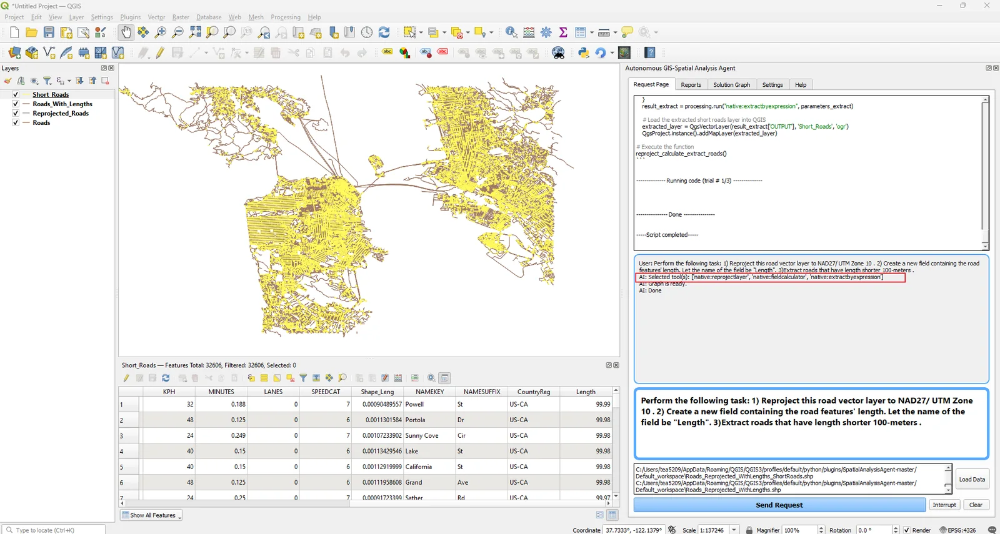
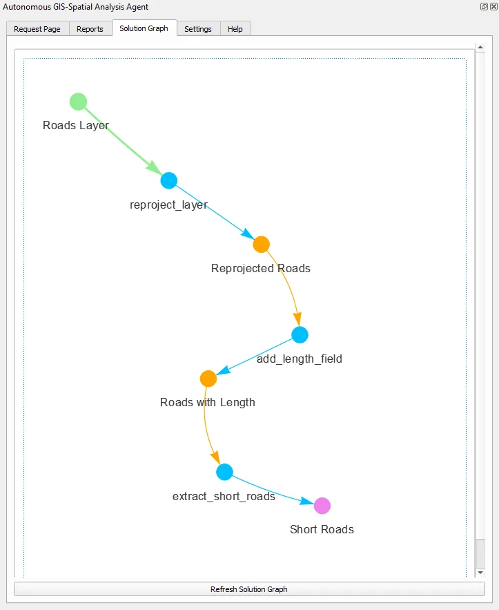
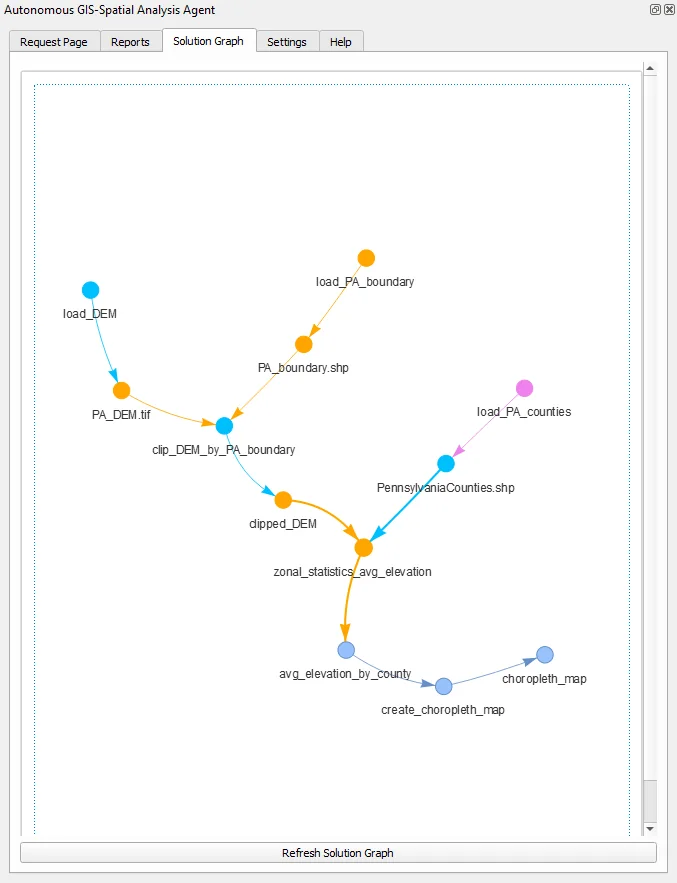
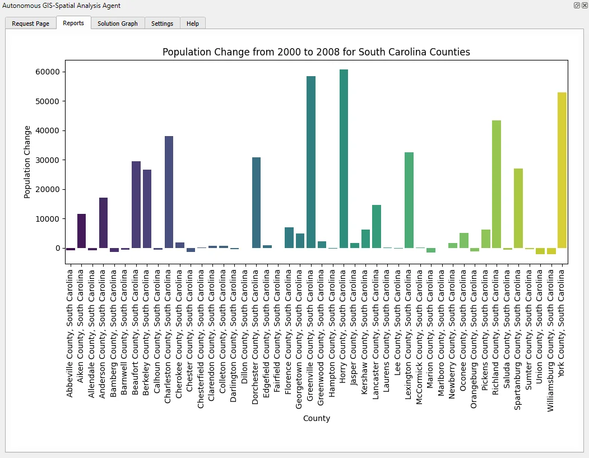

# Interface and workflows

<p class="lead">A tab-by-tab reference for the GIS Copilot panel and the full lifecycle of a request.</p>

<figure>
  
  <figcaption>The Request Page during a multi-step analysis. The labelled areas are described below.</figcaption>
</figure>

## Tabs at a glance

| Tab | Purpose |
| --- | --- |
| [**Request Page**](#request-page) | Choose data, describe the task, send it, and follow progress. |
| [**Generated Code**](#generated-code) | Read, edit, rerun, save, or load Python scripts. Execution output appears in **Output Window**. |
| [**Geoprocessing Workflow**](#geoprocessing-workflow) | The planned operations as an interactive graph. Older releases call this *Solution Graph*. |
| [**Reports**](#reports) | Charts and HTML reports produced by the analysis. |
| [**Settings**](#settings) | Model, key, reasoning effort, code review, workspace, and tool documentation. See [Configuration](configuration.md). |
| **Help** | Built-in guidance. |

Labels follow [the checked-in interface file](https://github.com/Teakinboyewa/SpatialAnalysisAgent/blob/master/SpatialAnalysisAgent_dockwidget_base.ui).

## Request Page

### Choose input data

GIS Copilot analyses the layers that are **ticked in the QGIS Layers panel**. Their file paths are listed in the data paths box above **Send Request**.

- To add a file that isn't loaded yet, select **Load Data**.
- Untick layers that are unrelated to the task. Extra layers add noise and can lead the model to the wrong input.
- Layers must be file-backed and readable. Temporary in-memory layers may have no path to pass on.

### Describe the task

Type the request in the message box. Name layers and fields exactly, state units and CRS, and say what output you want. [Writing effective requests](prompts.md) has templates and before-and-after examples.

### Send, interrupt, clear

| Button | Behaviour |
| --- | --- |
| **Send Request** | Starts the pipeline: data inspection → task breakdown → tool selection → workflow graph → code generation → (optional) review → execution → debugging if needed. |
| **Interrupt** | Asks the running request to stop. Code that already ran is **not** undone and files already written stay on disk. |
| **Clear** | Clears the panels. It doesn't delete layers or files. |

### Follow progress

The information panel narrates each stage:

```text
User: Perform the following task: 1) Clip the DEM to PA boundaries ...
AI: Selected tool(s): ['gdal:cliprasterbymasklayer', 'native:zonalstatisticsfb', 'thematic_map_creation']
AI: Geoprocessing workflow is ready.
AI: Done
```

Several items in this log are **clickable**:

- **Tool names** open the tool documentation that was given to the model.
- **Data summaries** show the attributes GIS Copilot read from your layers.
- **Reasoning links** show the model's task breakdown.
- **File paths** (for example a saved chart) ask for confirmation, then open the file.

Meanwhile the code panel shows the script and the execution log. If execution fails, GIS Copilot sends the error back to the model, regenerates the code, and tries again, **up to five attempts** in version 1.4:

```text
-------------- Running code (trial # 1/5) --------------
...
-------------- Done --------------
-----Script completed-----
```

<figure>
  
  <figcaption>A three-step vector request (reproject, compute length, extract roads shorter than 100 m). The execution log is in the code panel and the selected tools are boxed in red. The attribute table confirms the new <code>Length</code> field.</figcaption>
</figure>

### Rate the response

With a GIBD key, the thumbs-up, thumbs-down, and feedback-message buttons send a rating or comment for the last request to the GIBD feedback service. With other keys they're inactive. See [what is sent](configuration.md#credentials-and-request-data).

## Generated Code

This tab holds the final script that was executed.

| Control | Use it to… |
| --- | --- |
| **Run Code** | Execute the editor contents inside QGIS, after your edits for example. |
| **Save as a Python File** | Keep the script for reuse, review, or a methods appendix. |
| **Open from File** | Load a saved script into the editor. |
| **Output Window** | Read `print` output and errors from the last run. |

<div class="callout warning" markdown="1">
<span class="callout-title">Before you rerun</span>
Check the output paths. A rerun may overwrite files or add duplicate layers. Scripts also hard-code input paths, so a saved script only runs where those files exist.
</div>

A typical script for a multi-step request is organised as one function with numbered steps, unique output filenames, and explicit loading of each result into the project. See the [annotated example in the tutorials](examples.md#tutorial-3-mean-elevation-per-county-choropleth).

## Geoprocessing Workflow

Before writing code, GIS Copilot plans the task as a directed graph. It is saved as GraphML plus an interactive HTML view and shown in this tab.

<div class="figure-row">
  <figure>
    
    <figcaption>A linear plan: each operation feeds the next.</figcaption>
  </figure>
  <figure>
    
    <figcaption>A branching plan: two inputs meet at the clip, then join counties at zonal statistics.</figcaption>
  </figure>
</div>

Read it as follows:

- **Nodes** are data (inputs, intermediates, outputs) or operations. Colours distinguish their roles.
- **Edges** show which data feeds which operation.
- The view is interactive: drag nodes to untangle the layout and scroll to zoom.

The graph is the **plan**, not an execution record. After debugging, the final code can differ from it. When it matters, compare the graph with the code.

## Reports

When a task produces a chart or HTML table (for example a seaborn histogram, scatter plot, or correlation table), the file is saved to the workspace and shown here. Image files are wrapped in a simple HTML page for display.

<figure>
  
  <figcaption>A bar chart in the Reports tab. Ask for "clear labels" or a specific chart type in the request to shape the result.</figcaption>
</figure>

Not every analysis produces a report. Map outputs are added to the QGIS project as layers instead.

## Settings

<figure class="medium">
  
  <figcaption>The Settings tab. Version 1.4 adds a <em>local</em> model option with Base URL and <em>Fetch models</em>, and removes the RAG checkbox shown in this earlier capture.</figcaption>
</figure>

All options are explained in [Configuration](configuration.md).

## Where outputs go

- The **Workspace Directory** is passed to code generation as the output folder. The default is `Default_workspace` inside the plugin folder; change it to a project folder you control.
- Generated scripts usually add a numeric suffix rather than overwrite (`Clipped_DEM_1.tif`), but don't rely on this. Check the code.
- Workflow graph files (GraphML and HTML) are written during planning.
- Look in the information panel and Output Window for the exact paths written.

<div class="callout tip" markdown="1">
<span class="callout-title">Make results reproducible</span>
Keep the request text, input dataset versions, the final script (*Save as a Python File*), and outputs together. With these you can rerun or audit the analysis later without calling the model again.
</div>
